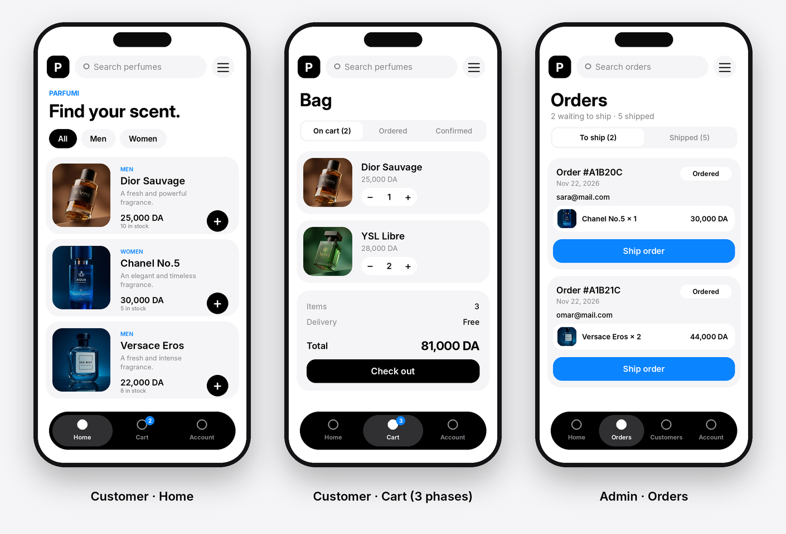
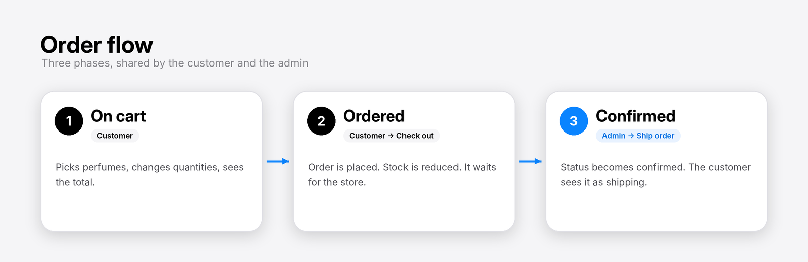
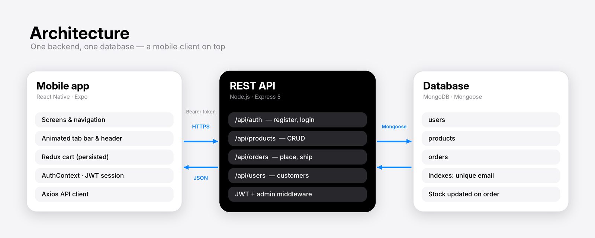
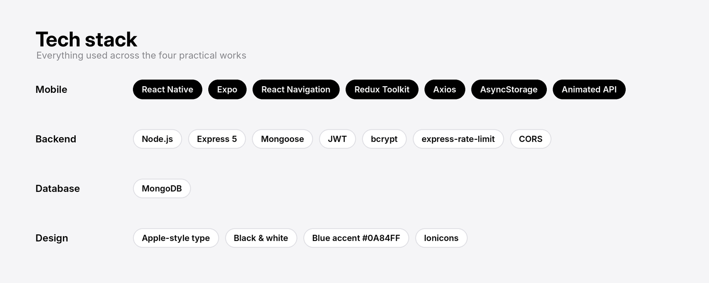
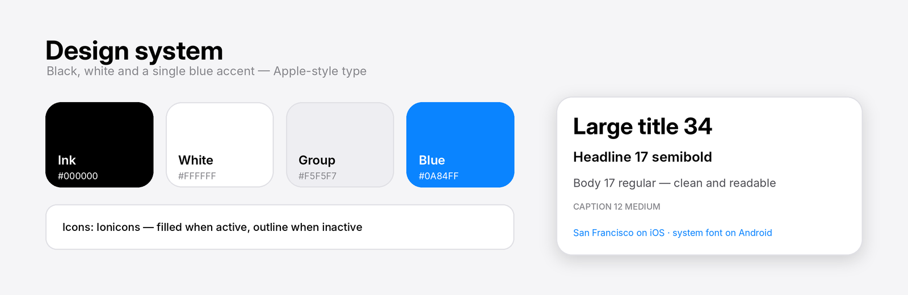
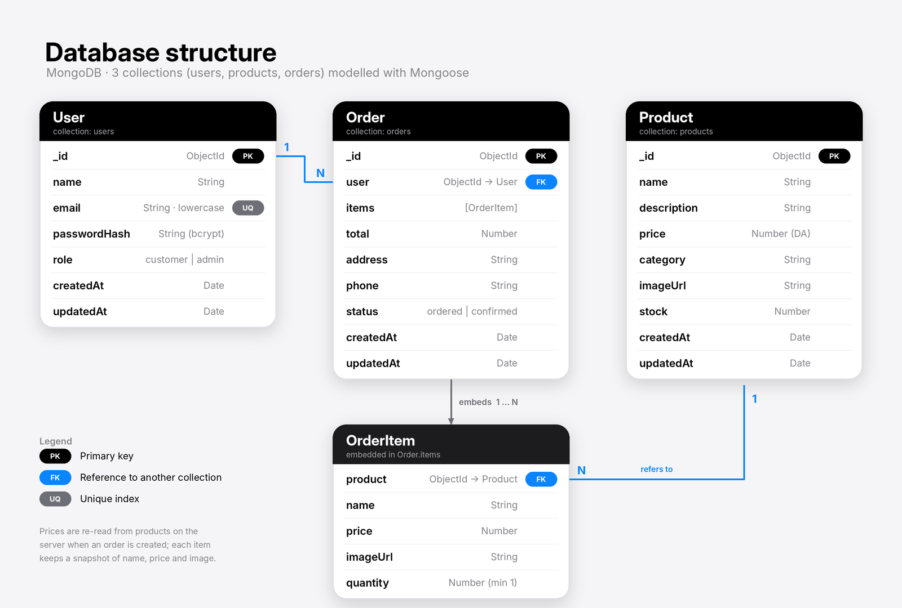

<div align="center">

# WAMD · TD/TP Assignments
 
**Web And Mobile Development — 4 practical works: portfolio → front end → full-stack web → mobile app.**
 


 


 
[About](#-about) · [Structure](#-repository-structure) · [Parfumi](#-featured-project--parfumi-tp-4--mobile) · [Database](#-database-structure) · [Getting started](#-getting-started) · [API](#-api-reference) · [Author](#-author)
 
</div>
---
 
## ✦ About
 
This repository gathers the **4 TD/TP assignments** of the *Web And Mobile Development* module.
It follows one learning path: a personal **portfolio**, then the **front end** of an online perfume store,
then the same store as a **full-stack web app**, and finally the **mobile app** on top of the same backend.
 
## ✦ Repository structure
 
```text
WAMD-TP-s/
├── TD-TP-1/             # TP 1 · Portfolio
├── TD-TP-2/             # TP 2 · Front-end web (Parfumi store)
├── TD_TP_3/             # TP 3 · Full-stack web (Parfumi + API + database)
├── 04-parfumi-mobile/   # TP 4 · Mobile app (React Native) + backend
├── assets/              # Images used by this README
├── .gitignore
└── README.md
```
 
| TP | Folder | Project | What it is | Stack |
| :-: | :-- | :-- | :-- | :-- |
| **1** | [`TD-TP-1`](./TD-TP-1) |  **Portfolio** | Personal portfolio website | Web front end |
| **2** | [`TD-TP-2`](./TD-TP-2) |  **Front-end web** | The Parfumi store interface: products, search, cart | Web front end |
| **3** | [`TD_TP_3`](./TD_TP_3) |  **Full-stack web** | The store connected to a real API, database and authentication | Express · MongoDB · JWT |
| **4** | [`04-parfumi-mobile`](./04-parfumi-mobile) |  **Mobile app** | Parfumi as a native app with customer and admin roles | React Native · Expo · Express · MongoDB |
 
> The TP 4 folder keeps its original name. Rename it to `TD-TP-4` if you want the repo to be consistent,
> and update the paths in this file.
 
---
 
## ✦ Featured project · PARFUMI (TP 4 — Mobile)
 

> The mobile version of the store built in TP 2 and TP 3 — it reuses the same Express + MongoDB backend and feels like a real app: Apple-style design, a floating animated tab bar,
> a three-phase cart, and an admin side to manage products, orders and customers.
 
<div align="center">

<sub>UI previews of the main screens: customer home, the three-phase cart, and admin orders.</sub>
</div>
### Features
 
<table>
<tr>
<td width="50%" valign="top">
#### 🛍 Customer
- **Home** — one perfume per row: picture on the left, name, details and price on the right
- Category chips and live **search** from the header
- Product page with quantity picker and sticky *Add to bag* bar
- **Cart in 3 phases:** `On cart → Ordered → Confirmed (shipping)`
- Checkout with delivery address and phone, order progress tracker
- **Account** — profile picture, email, customer ID, number of orders, member since
</td>
<td width="50%" valign="top">
#### 🛠 Admin
- **Home** — revenue, orders to ship, product count, quick *Add perfume*
- Tap a perfume to open it, or **Edit / Delete** it
- **Orders** — *To ship* and *Shipped* lists with a **Ship order** button
- **Customers** — profile picture, email and ID of every customer
- **Account** — role, orders handled, customers count
</td>
</tr>
</table>
**Shared:** header with `P` logo · search bar · menu button, floating **animated bottom navigation**
(3 tabs for customers, 4 for admins), JWT authentication, persistent cart, pull-to-refresh, loading / empty / error states.
 
### How an order moves
 

| Phase | Customer sees | Who triggers it |
| :-- | :-- | :-- |
| **On cart** | Items, quantities, total | Customer |
| **Ordered** | Order waiting for the store | Customer → *Check out* |
| **Confirmed** | *Confirmed · Shipping* + progress tracker | Admin → *Ship order* |
 
### Architecture
 

### Tech stack
 

### Design system
 

---
 
## ✦ Database structure
 

| Collection | Purpose | Key fields |
| :-- | :-- | :-- |
| **users** | Customers and admins | `name`, `email` (unique), `passwordHash`, `role` |
| **products** | The perfume catalogue | `name`, `price`, `category`, `imageUrl`, `stock` |
| **orders** | Placed orders | `user` → users, embedded `items[]`, `total`, `status`, `address`, `phone` |
 
- One **user** places many **orders**.
- Each order **embeds** its items; every item points to a **product** and keeps a snapshot of its name, price and image.
- `status` is `ordered` until an admin presses *Ship order*, then `confirmed`.
---
 
## ✦ Getting started
 
**Requirements:** Node.js 18+, a MongoDB connection string, and Expo Go on your phone (or an emulator).
 
```bash
# 1. Clone
git clone https://github.com/abdeldjabbar01/WAMD-TP-s.git
cd WAMD-TP-s/04-parfumi-mobile
 
# 2. Configure the backend
cp backend/.env.example backend/.env
#    then edit backend/.env → set MONGO_URI and JWT_SECRET
 
# 3. Run everything with one command
npm start
```
 
`npm start` installs the dependencies on the first run, starts the API on port **5000**, then starts Expo and prints a **QR code**.
Scan it with Expo Go (phone and computer on the same Wi-Fi). The app finds the backend automatically.
 
```bash
npm run seed     # insert the sample perfumes (first run with an empty database)
```
 
<details>
<summary><b>Environment variables</b></summary>
| File | Variable | Description |
| :-- | :-- | :-- |
| `backend/.env` | `PORT` | API port (default `5000`) |
| `backend/.env` | `MONGO_URI` | MongoDB connection string |
| `backend/.env` | `JWT_SECRET` | Long random secret used to sign tokens |
| `mobile/.env` | `EXPO_PUBLIC_API_URL` | Optional — force the API address, e.g. `http://192.168.1.20:5000/api` |
 
</details>
<details>
<summary><b>Creating an admin account</b></summary>
Registration always creates a **customer**. To make someone an admin, register normally, then set
`role: "admin"` on that user in the `users` collection of MongoDB and sign in again.
 
</details>
---
 
## ✦ API reference
 
Base URL: `http://<host>:5000/api` —  means a Bearer token is required,  means admin only.
 
| Method | Endpoint | Access | Description |
| :-- | :-- | :-: | :-- |
| `POST` | `/auth/register` | | Create a customer account |
| `POST` | `/auth/login` | | Sign in, returns token and user |
| `GET` | `/products` | | List perfumes |
| `GET` | `/products/:id` | | One perfume |
| `POST` `PUT` `DELETE` | `/products` · `/products/:id` |  | Add, edit, delete a perfume |
| `POST` | `/orders` |  | Place an order (prices and stock checked server-side) |
| `GET` | `/orders/mine` |  | My orders |
| `GET` | `/orders` |  | All orders with customer info |
| `PATCH` | `/orders/:id/ship` |  | Confirm and ship an order |
| `GET` | `/users` |  | Customers: id, email, picture, orders count |
 
## ✦ Project layout
 
```text
04-parfumi-mobile/
├── backend/
│   ├── models/        User · Product · Order
│   ├── routes/        authRoutes · orderRoutes · userRoutes
│   ├── middleware/    JWT protect · admin guard
│   └── server.js
├── mobile/
│   ├── App.js         navigation (customer vs admin tabs)
│   └── src/
│       ├── components/  AppHeader · TabBar · MenuSheet · ProductRow · OrderCard · Segmented …
│       ├── screens/     Home · Cart · Account · AdminHome · Orders · Customers · …
│       ├── context/     Auth · Search
│       ├── store/       Redux cart (persisted)
│       └── theme.js     colors & Apple-style type scale
└── start.js           one-command launcher
```
 
## ✦ Roadmap
 
- [ ] Upload a real profile picture
- [ ] Order history details and cancellation
- [ ] Push notification when an order is shipped
- [ ] Favorites / wishlist
## ✦ Author
 
**abdeldjabbar01** — [github.com/abdeldjabbar01](https://github.com/abdeldjabbar01)
 
<div align="center">
<sub>Built for the WAMD module · ENSTA</sub>
</div>
 