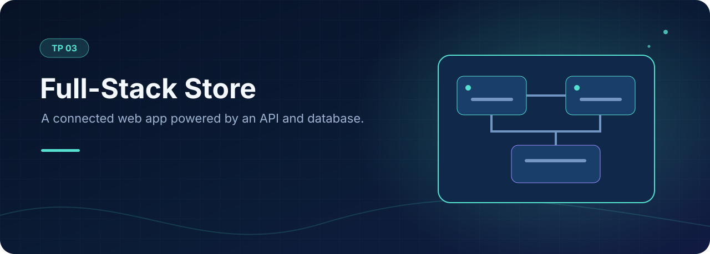

  
   
  
  <h1>WAMD · Web and Mobile Development</h1>
  
A collection of four practical assignments covering portfolio design, e-commerce interfaces, full-stack development, and mobile applications.

---

## TP 01 — Personal Portfolio

A personal portfolio website that presents an individual profile and showcases projects and skills.  
This assignment focuses on structuring a personal web presence through a clear interface.  
[Open TP 01](.TD-TP-1_protfolio)

## TP 02 — Parfumi Store Interface

A front-end interface for an online perfume store named Parfumi.  
It introduces a product catalogue, product browsing, search, and a shopping cart experience.  
[Open TP 02](.TD-TP-2_Frontend_web)

## TP 03-04 — Backend-Full-Stack Parfumi Store

The Parfumi storefront extended with a backend, database, and authentication.  
The application uses Express, MongoDB, and JWT to support user access, product management, and order handling.  
[Open TP 03](.TD-TP-3-4_Backend+Fullstck_web)

## TP 05 — Parfumi Mobile App

A mobile version of the Parfumi store built with React Native and Expo.  
It provides customer and admin experiences while reusing the Express and MongoDB backend introduced in TP 03.  
[Open TP 04](.TD-TP-5_Mobile_app)

---

## Database Schema

The data model is organised around three main collections: users, products, and orders.  
A user can place multiple orders, and each order stores its items with relevant product details.  

## Application Architecture

The web and mobile applications communicate with the same Express API and MongoDB database.  

## Order Flow

An order moves from the cart to checkout, then to confirmation and shipping through the admin side.  

---

## Author

**abdeldjabbar01**  
Web and Mobile Development — ENSTA
