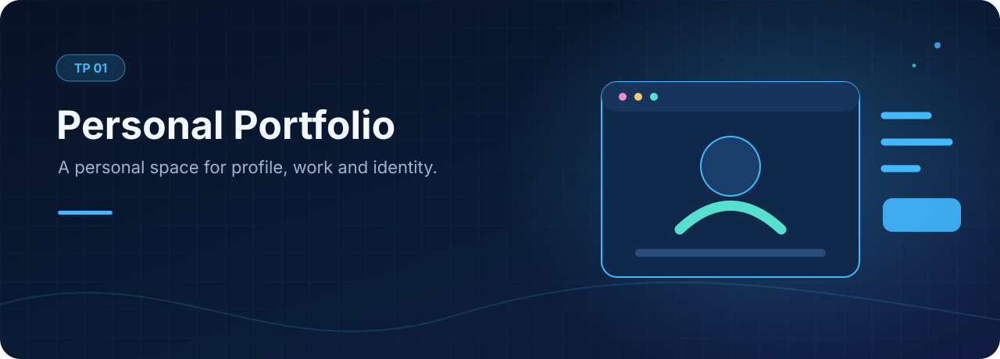

<div align="center">
  
  <h1>TP 01 — Personal Portfolio</h1>
  <p>A personal website for presenting profile, skills, and selected work.</p>
</div>

---

## Overview

This TP focuses on building a personal portfolio website.
The portfolio gives visitors a clear introduction to its owner and presents selected work in one place.
The page is organised around a simple visual identity and a clear path through the content.

## Main Topics

### Personal introduction
A first section that introduces the portfolio owner and establishes the page identity.

### About and skills
A place to present background information, interests, and technical skills.

### Selected projects
A section that highlights completed work and gives each project a clear presentation.

### Contact information
A direct way for visitors to find the portfolio owner or get in touch.

## Technologies

The exact tools and libraries should match the source files in this folder.
Keep the technology list limited to tools that are actually used in the project.

## Project Structure

The section below describes the documentation and presentation files for this TP.

```text
TD-TP-1/
├── assets/           # Banner and project visuals
├── css/              # Stylesheets
├── images/           # Interface images
├── js/               # JavaScript source
├── screenshots/      # Interface screenshots
├── index.html        # Main HTML page
├── WAMD_TP_TD_01.pdf # Assignment report
└── README.md         # Project documentation
```

The application source files remain in the project folders already provided by the repository.

## Assets

The `assets` folder contains the visual banner for this TP.

## Screenshots

Add real screenshots of the finished project to the `screenshots` folder.

Suggested screenshot names and contents:

- `home.png` — The first screen of the portfolio, including the main introduction.
- `about-skills.png` — The about section and the skills presentation.
- `projects.png` — The projects section with visible project cards or links.
- `mobile-view.png` — A mobile-sized view that shows the responsive layout.

