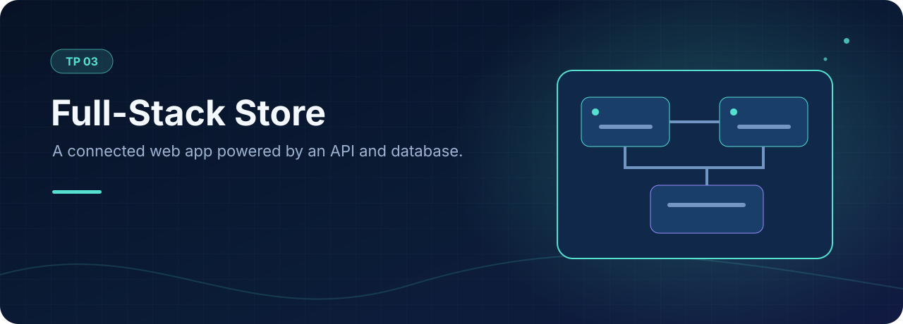
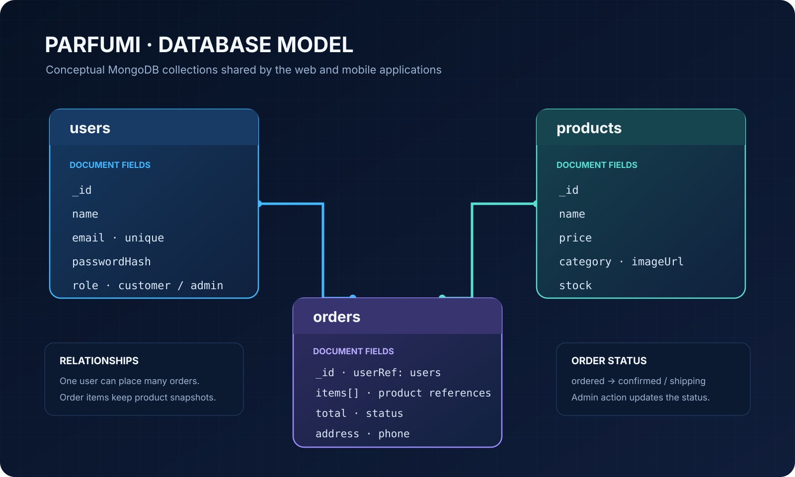
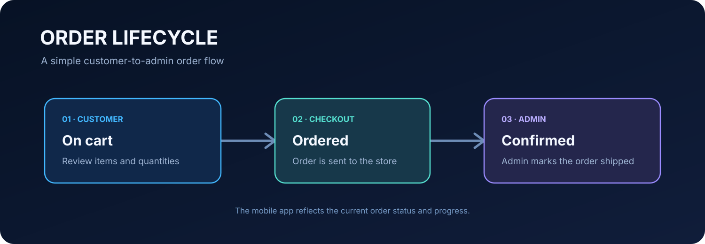

<div align="center">
  
  <h1>TP 03 — Full-Stack Parfumi Store</h1>
  <p>A perfume store extended with an API, database, and user authentication.</p>
</div>

---

## Overview

This TP extends the Parfumi storefront with a server-side application and persistent data storage.
The backend is built around Express, MongoDB, and JSON Web Tokens for authentication.
The application connects the store interface to data and operations handled by the server.

## Main Topics

### REST API
Server endpoints that allow the client application to communicate with the backend.

### Authentication
JWT-based authentication for protected user operations.

### Product management
Backend support for storing and managing perfume product information.

### Order management
Backend support for recording and managing customer orders.

### Database
MongoDB collections that store users, products, and orders.

## Technologies

Express is used for the backend application.
MongoDB is used for data storage.
JWT is used for authentication.

## Project Structure

The section below describes the documentation and presentation files for this TP.

```text
TD-TP-3/
├── Parfumi-Store-Fullstack/        # Full-stack frontend and backend project
├── assets/                         # Banner, database schema, and order-flow visuals
├── screenshots/                    # Interface screenshots
├── Parfumi-Store-TD-TP3-Report.pdf # Project report
└── README.md                       # Project documentation
```

The application source files remain in the project folders already provided by the repository.

## Assets

The `assets` folder contains the visual banner for this TP.

### Database Schema

<p align="center"></p>

The diagram gives a visual overview of the main users, products, and orders data groups.

### Order Flow

<p align="center"></p>

The diagram represents the general movement of an order through the store.

## Screenshots

Add real screenshots of the finished project to the `screenshots` folder.

Suggested screenshot names and contents:

- `storefront.png` — The connected storefront displaying product data.
- `authentication.png` — A successful sign-in or registration interface.
- `product-management.png` — The product management view, if an admin interface is included.
- `orders.png` — An order view that demonstrates the order data or its management.

