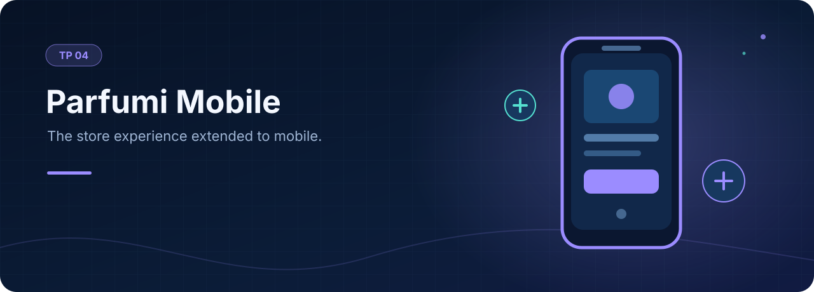
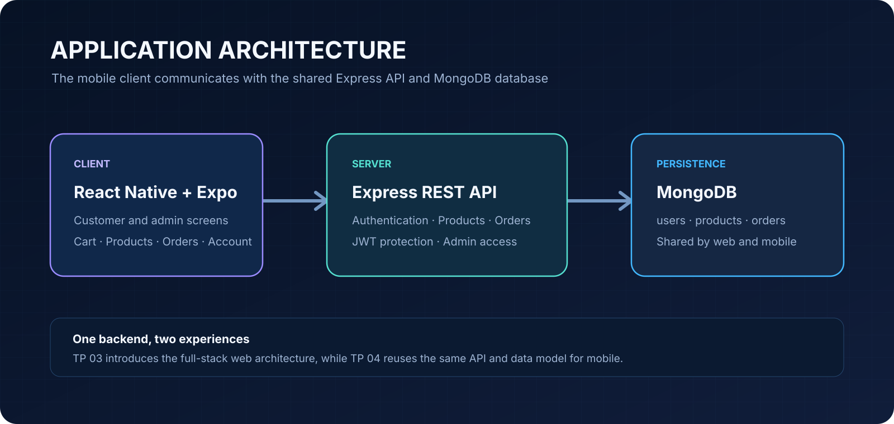
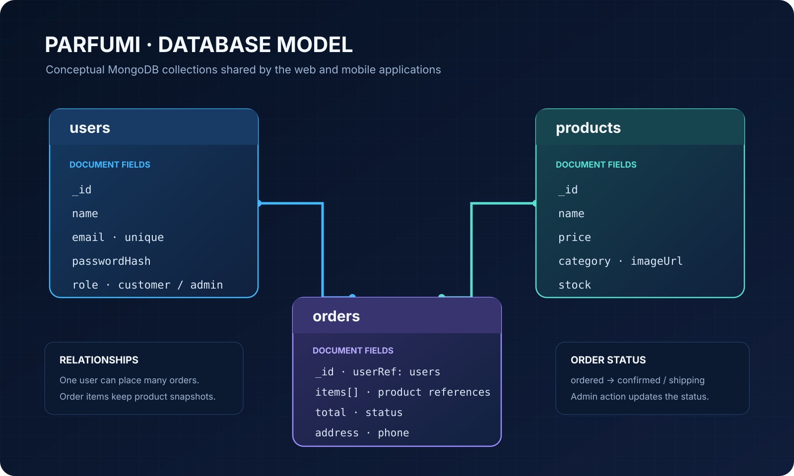
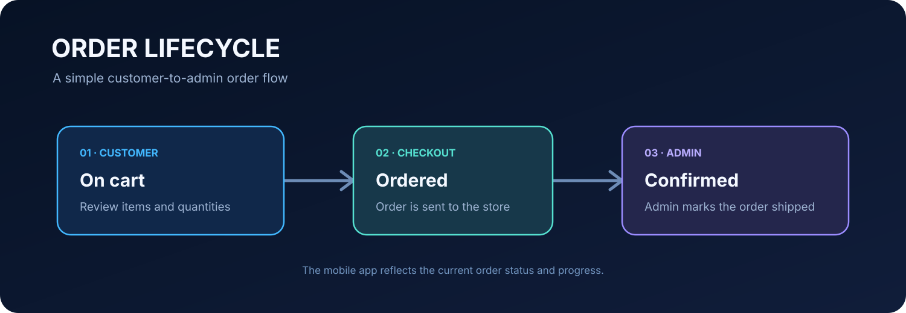

<div align="center">
  
  <h1>TP 04 — Parfumi Mobile App</h1>
  <p>A mobile shopping application built with React Native and Expo.</p>
</div>

---

## Overview

This TP brings the Parfumi shopping experience to mobile devices.
The application is built with React Native and Expo.
It communicates with the Express and MongoDB backend introduced in TP 03.
The mobile project includes customer and admin experiences.

## Main Topics

### Mobile interface
Screens designed for mobile navigation and touch interaction.

### Customer experience
A customer-facing flow for discovering products and interacting with the store.

### Admin experience
Administrative screens for the store operations included in the project.

### Backend connection
Communication with the shared backend API from TP 03.

### Shared data
The web and mobile clients work with the same store data managed by the backend.

## Technologies

React Native is used to build the mobile interface.
Expo provides the React Native development platform.
The app connects to the Express and MongoDB backend from TP 03.

## Project Structure

The section below describes the documentation and presentation files for this TP.

```text
TD-TP-4/
├── backend/          # Server, database models, routes, and API configuration
├── mobile/           # React Native mobile application
├── assets/           # Banner and architecture diagrams
├── screenshots/      # Interface screenshots
├── package.json      # Project dependencies and scripts
├── start.js          # Application startup script
└── README.md         # Project documentation
```

The application source files remain in the project folders already provided by the repository.

## Assets

The `assets` folder contains the visual banner for this TP.

### Mobile Architecture

<p align="center"></p>

The diagram shows the mobile app communicating with the shared backend API and database.

### Database Schema

<p align="center"></p>

The mobile app uses the same store data model as the web application.

### Order Flow

<p align="center"></p>

## Screenshots

Add real screenshots of the finished project to the `screenshots` folder.

Suggested screenshot names and contents:

- `home.png` — The main mobile screen.
- `products.png` — The mobile product browsing screen.
- `product-details.png` — The mobile product details screen.
- `admin.png` — An admin screen, if included in the mobile app.

