<div align="center">
  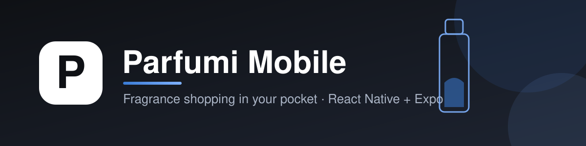
  <h1>TP 04 — Parfumi Mobile App</h1>
  <p><b>A mobile fragrance shopping application built with React Native and Expo</b></p>
  <p>
    
    
    
    
  </p>
</div>

---

## Table of Contents

- [Overview](#overview)
- [Features](#features)
- [Screenshots](#screenshots)
- [Technologies](#technologies)
- [Architecture](#architecture)
- [Project Structure](#project-structure)
- [Getting Started](#getting-started)
- [Roles](#roles)

---

## Overview

Parfumi Mobile brings the Parfumi shopping experience to phones.

The application is built with React Native and Expo.

It communicates with the Express and MongoDB backend introduced in TP 03.

The same store data is shared between the web client and the mobile client.

The mobile project includes two experiences, one for customers and one for the store administrator.

---

## Features

### Customer experience

- Browse the full fragrance catalogue with price and availability
- Filter products by category with quick chips such as All, Women, Men, Blue and Summer
- Search fragrances from the header search bar
- Add products to the cart with a single tap
- Adjust quantities or remove items from the cart
- Place an order and follow it through the Ordered and Shipped tabs
- Create an account, sign in and manage the profile

### Admin experience

- Dedicated navigation with Discover, Orders, Customers and Account
- Orders screen showing every order with customer, items, date and total
- Fulfilment status for each order, from Ordered to Shipped
- Customers screen listing all registered customers with their identifiers
- Account screen showing the Store Administrator profile

### Shared behavior

- One backend API for web and mobile
- Same products, users and orders on both clients
- Cart badge that updates live on the header and on the tab bar

---

## Screenshots

### Customer

<p align="center">
  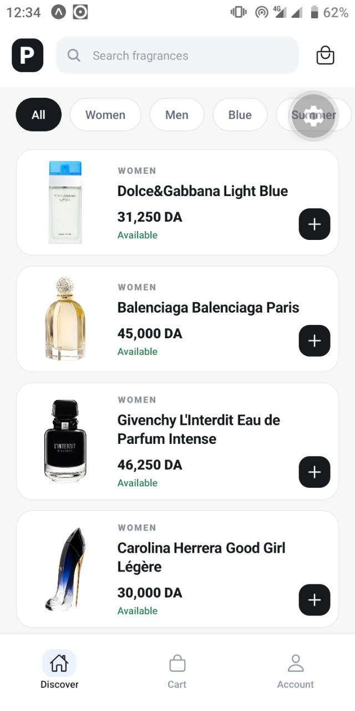
  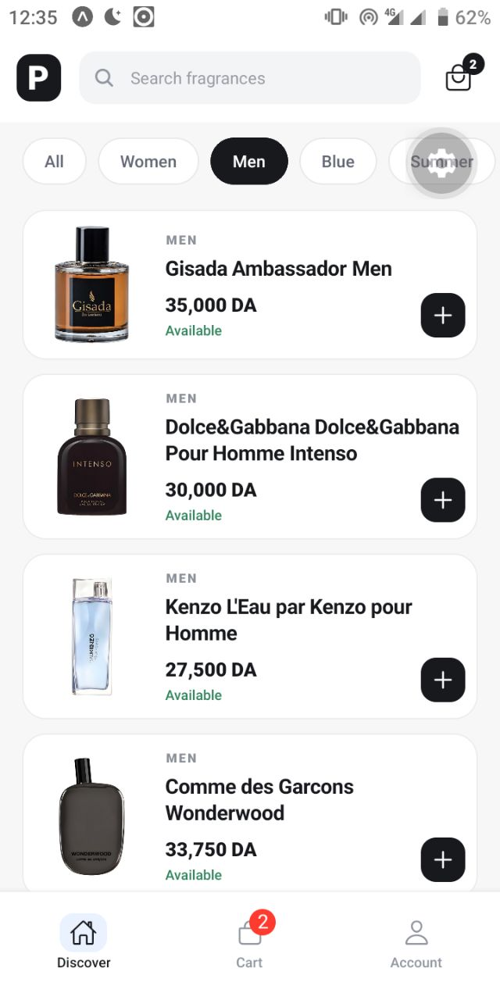
  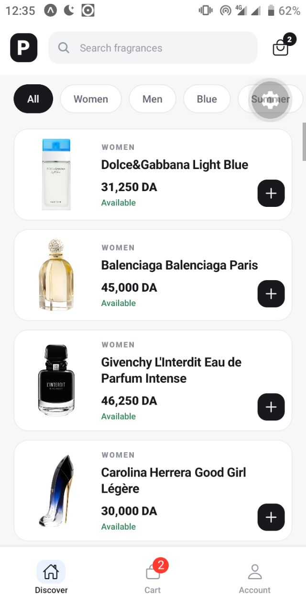
  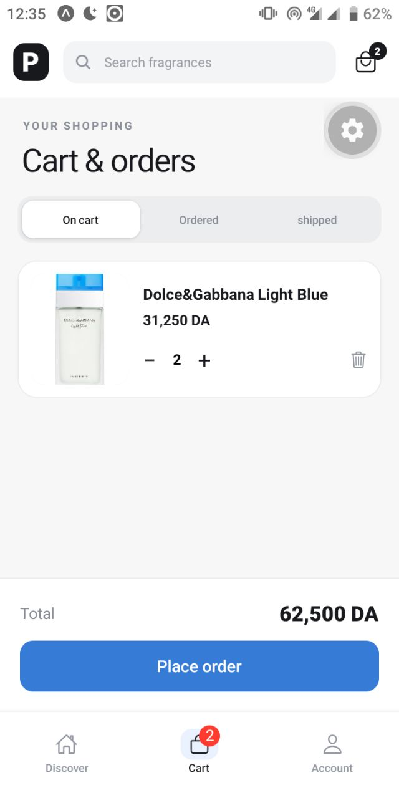
</p>

The first screen shows the home catalogue with category chips.

The second screen shows the Men category filter.

The third screen shows the cart badge after adding a product.

The fourth screen shows the cart with quantity controls and the Place order button.

<p align="center">
  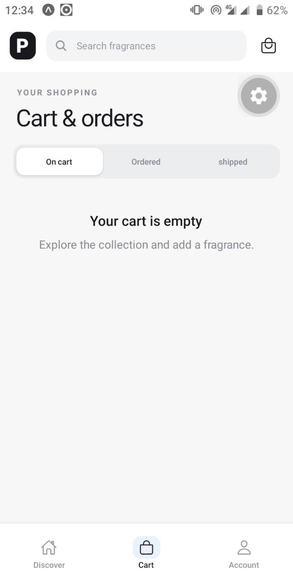
  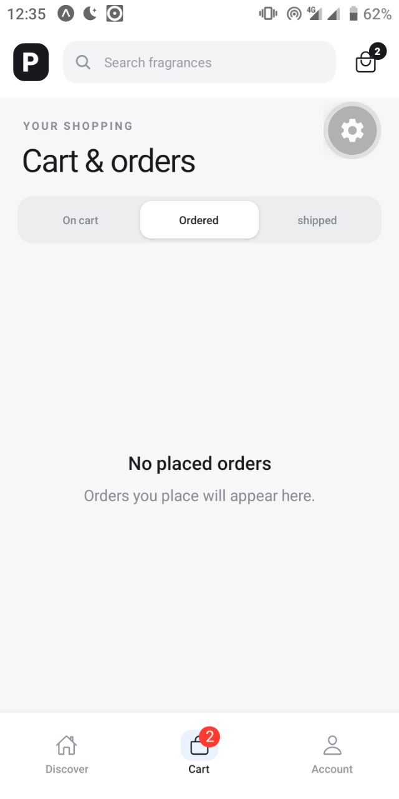
  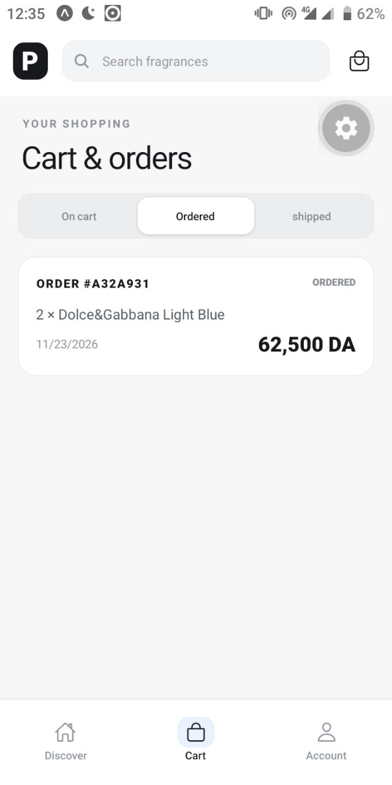
  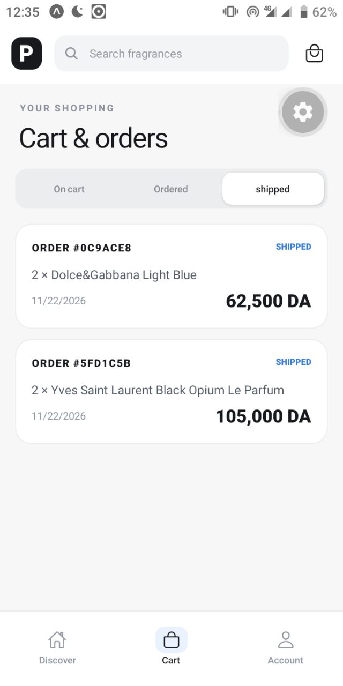
</p>

The first screen shows the empty cart state.

The second screen shows the empty Ordered tab.

The third screen shows a freshly placed order.

The fourth screen shows orders already marked as shipped.

<p align="center">
  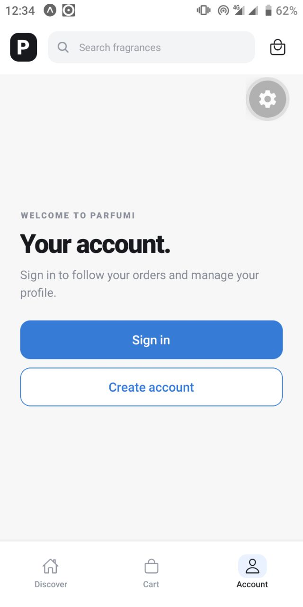
</p>

The guest account screen invites the visitor to sign in or create an account.

### Admin

<p align="center">
  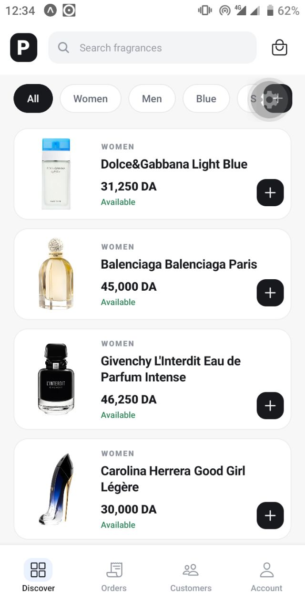
  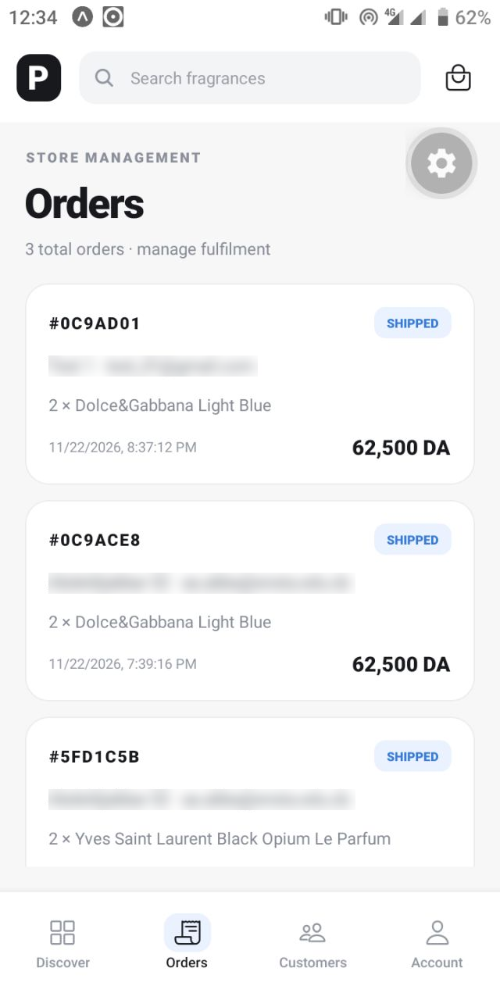
  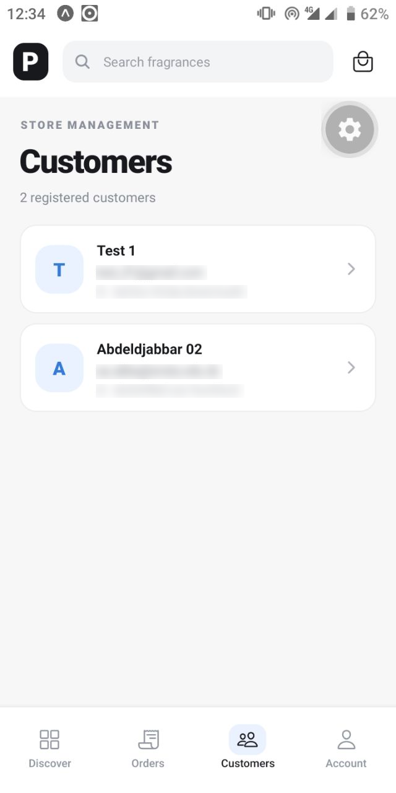
  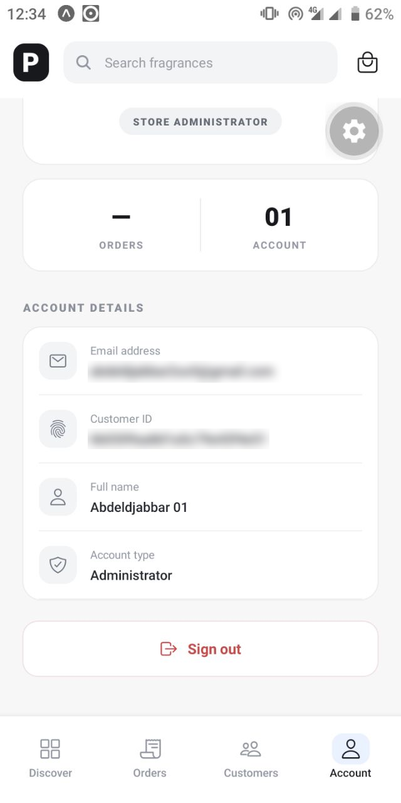
</p>

The first screen shows the admin tab bar with Discover, Orders, Customers and Account.

The second screen shows store management for orders and fulfilment.

The third screen shows the list of registered customers.

The fourth screen shows the administrator account details.

Personal details such as emails and identifiers are blurred in the screenshots.

---

## Technologies

React Native builds the mobile interface.

Expo provides the development platform and the tooling to run the app on a real device.

Express exposes the REST API used by the app.

MongoDB stores users, products and orders.

---

## Architecture

### Mobile Architecture

<p align="center">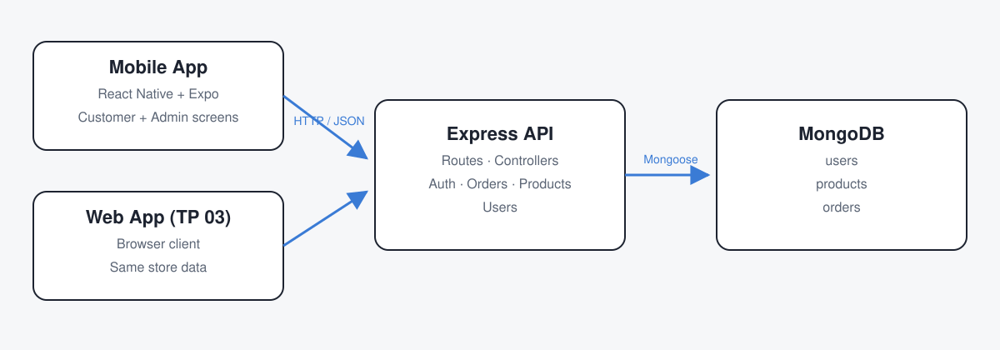</p>

The mobile app and the web app both talk to the same Express API.

The API reads and writes the data in MongoDB.

### Database Schema

<p align="center">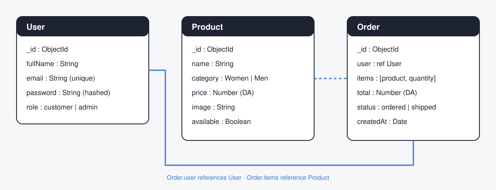</p>

Users own orders.

Each order contains product lines with a quantity and a total price in DA.

### Order Flow

<p align="center">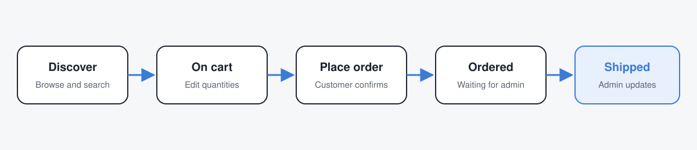</p>

The customer discovers a fragrance and adds it to the cart.

Placing the order moves it to the Ordered state.

The administrator then updates the order to Shipped.

---

## Project Structure

```text
TD-TP-4/
├── backend/          # Server, database models, routes, and API configuration
├── mobile/           # React Native mobile application
├── assets/           # Banner and architecture diagrams
├── screenshots/      # Interface screenshots
├── package.json      # Project dependencies and scripts
├── start.js          # Application startup script
└── README.md         # Project documentation
```

---

## Getting Started

### Prerequisites

- Node and npm installed
- A running MongoDB instance or a MongoDB Atlas connection string
- The Expo Go app on a phone, or an Android or iOS emulator

### Install

```bash
npm install
cd mobile && npm install
```

### Run the backend

```bash
cd backend
npm start
```

### Run the mobile app

```bash
cd mobile
npx expo start
```

Scan the QR code with Expo Go to open the app.

The phone and the computer must be on the same network.

Set the API base URL in the mobile configuration to the local IP address of the computer running the backend.

---

## Roles

Customers can browse, order and follow their orders.

Administrators can manage orders, see customers and monitor the store.

---

<div align="center">
  <sub>Parfumi Mobile · TP 04 · React Native + Expo</sub>
</div>
